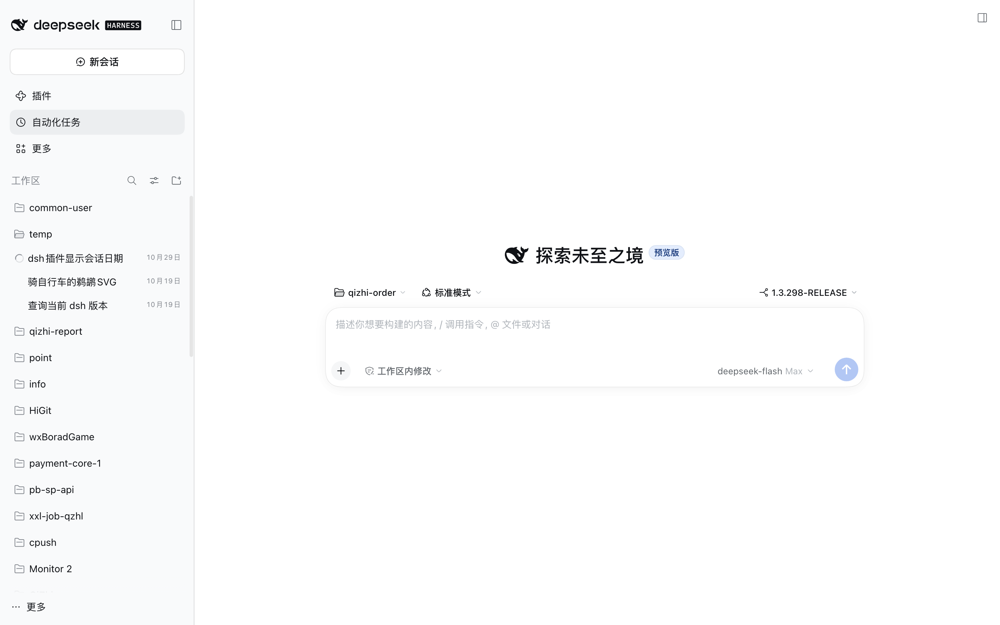
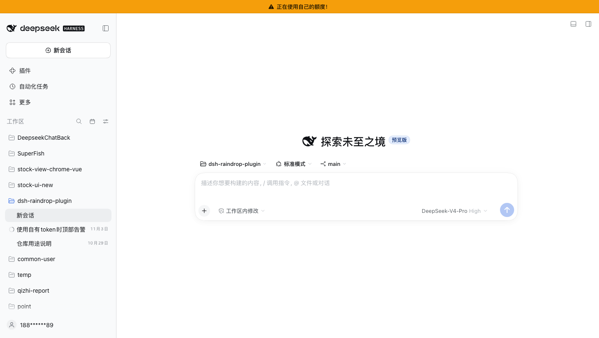

# dsh-raindrop-plugin

A DSH web GUI plugin that shows each sidebar session's **calendar day** instead of a relative age ("just now / 5 min / 3 days"), plus a **Date view** panel in the sidebar header (pick which date the row shows, sort by date, filter by date range), a **search field in the new-session workspace picker**, and a **top alert while the selected model spends your own DeepSeek quota**.



```
before:  刚刚   5分钟   3小时   3天   2个月
after:   10月29日 10月29日 10月29日 10月26日 8月30日
```

Sessions outside the current year include the year (`2025年10月29日`); the English UI renders `Oct 29` / `Oct 29, 2025`.

## Features

- **Inline dates**: every session row ends with a calendar day (last activity by default, switchable to first conversation).
- **Workspace picker search**: opening the new-session workspace menu adds a search field at the top. The picker shows at most five workspaces at a time; the rest scroll, with the search field and the add-workspace footer staying visible. Typing filters the list to matching workspaces. `↑`/`↓` move the highlight, `Home`/`End` jump to the first/last match, and `Enter` switches to the highlighted row (or, when nothing is highlighted, the exact label, then the first match). With no match the field's underline turns orange and `Enter` does nothing.
- **Own-quota alert**: while the model selected for the conversation on screen is served by your own DeepSeek account (`deepseek-account` login route or `deepseek-official` API-key route), a fixed amber strip at the top of the window reads **“正在使用自己的额度！”** / **“You are using your own quota!”**. It disappears as soon as another provider is selected and never blocks the UI. Third-party gateways such as `qz` keep their own billing and do not trigger it.
- **Date view panel**: the calendar button in the sidebar header, left of the native view-options sliders.
  - Show date: `Last activity` / `First message`
  - Sort by date: `Default (sidebar order)` / `Date: newest first` / `Date: oldest first`
  - Filter by date: `All` / `Today` / `Last 7 days` / `Last 30 days` + a custom `from`/`to` range
  - `Clear filter`
- Preferences persist in `localStorage` across reloads.
- Sorting and filtering apply to the rows currently rendered. In workspace-grouped mode, each expanded workspace is sorted internally; collapsed workspaces are not expanded automatically.
- "First message" is the Session header's `createdAt` (read on the Host). If a blank draft is left unused for days before its first prompt, that day can precede the first message. Exact first-user-message time would require scanning the full log and is not implemented.

## Own-quota alert



The alert follows the **model selected for the conversation on screen**, not a global account state: switch the model to a third-party provider and it goes away; switch back to a `DeepSeek 账号` model and it returns. The same strip stays visible while you visit the plugin manager or other entry pages, so navigating around the app does not hide the fact that the next request will spend your own balance.

The providers that count as “own quota” are one constant at the top of [`lib/client.js`](lib/client.js):

```js
const OWN_QUOTA_PROVIDERS = new Set(["deepseek-account", "deepseek-official"]);
```

`deepseek-account` is the DeepSeek account-login route and `deepseek-official` is the official API-key route. Add a provider id (for example `"qz"`) to warn about a third-party account as well, or remove one to stop warning about it. The ids are the same `data-provider-id` values the model picker exposes; the plugin never reads an API key, an account token, or the account balance.

## Install

From npm (recommended):

```bash
dsh plugin --profile web add dsh-raindrop-plugin
```

From a local checkout (link, for development):

```bash
dsh plugin --profile web add /absolute/path/to/dsh-raindrop-plugin
```

The package declares `dsh.bundle.patch`, so the plugin manager installs it as a profile bundle, inserts the `ui-raindrop-plugin` row, and records it in `dsh.profile.bundles`. Refresh the browser tab after installing. No rebuild is needed — `lib/client.js` is hand-written in the same module format as the shipped client bundles.

After editing the **Host half** (`lib/index.js`) of an installed link package, `dsh web` replaces it on the next profile reload — edit `~/.dsh/profiles/<name>/cordis.patch.yml` once (for example add and remove a comment), or restart `dsh web`. Client-only changes just need a page refresh. Registry installs are plain copies, so reinstall to pick up edits.

To remove it:

```bash
dsh plugin --profile web remove dsh-raindrop-plugin
```

## Changing the date style

The style is two constants at the top of [`lib/client.js`](lib/client.js):

```js
const FORMAT = "localized"; // localized | numeric | iso
const SHOW_YEAR = "auto";   // auto | always | never
```

| FORMAT | example |
| --- | --- |
| `localized` (default) | `10月29日` / `Oct 29` |
| `numeric` | `10-29` (year prefix per `SHOW_YEAR`) |
| `iso` | `2026-10-29` |

`SHOW_YEAR` controls when the year is included: `auto` (only outside the current year), `always`, or `never`. With a link install, save the file and refresh the tab — no reinstall, no rebuild. A registry install is a copy, so reinstall the package after editing.

The plugin can also be switched off entirely from the GUI's plugin settings, like any profile bundle.

## How it works

`@deepseek-ai/dsh-client-ui-workspace` ships only a bundled `lib/client.js`; neither the row clock nor the header action list is a slot, so there is no declarative seam. The plugin uses the UI's own stable contracts:

**Inline dates**

1. `ctx.sessions` supplies `byId[id].updatedAt`; the first-conversation day comes from this package's Host route (`createdAt`).
2. Each `[data-row-key="session:<id>"]` row's clock span (CSS-module local `_time`) gets a `data-dsh-session-date` attribute with the formatted day.
3. An injected stylesheet hides the relative text (`font-size: 0`) and paints the stamped day through `::after { content: attr(...) }`. React keeps owning its text nodes; the plugin never rewrites them.
4. A filtered `MutationObserver` (session rows and the sidebar header only) plus a `ctx.sessions.list` subscription re-stamp rows on list changes, new rows, pending-activity transitions, and locale switches. Pending rows (`aria-hidden="true"`) keep their status label.

**Sorting and filtering**

5. While date sorting is on, the rows' direct parent temporarily becomes a flex column and each row wrapper gets a CSS `order`. React keeps owning document order; no node is moved.
6. Rows outside the range get one hidden attribute; a workspace section whose sessions are all filtered out is hidden, and an empty-range notice appears at the top of the list.

**Host route**

7. The browser cannot see `createdAt` (`session.list` only carries `updatedAt`), so the Host half reads durable headers through the public `sessionQuery.listSessions()` and serves `GET /session-date/dates` as `{ sessions: { [id]: createdAt }, fetchedAt }`. The route passes `connection.authorizeIndex` (401 without the browser session cookie) and exposes only ids and creation instants — no titles, prompts, or paths — with a 15 s cache.

**Own-quota alert**

8. The composer's model label carries `data-provider-id` (the documented `conversation.input.model.label` contract), which is the live source. When no composer is mounted (plugin manager, settings), the selected Session's durable `projectionValues.modelSelection.next` / `lastUsed` from `ctx.sessions.list` stands in, and the last known provider bridges the gap while navigating.
9. The warning is a body-level fixed strip. Showing it adds a `data-dsh-own-quota` attribute to `#root`, whose stylesheet rule reserves the 32px top band while the strip is fixed over that band; hiding it removes the attribute and the frame returns to its previous height. No React-owned node is moved or replaced.

If a future DSH build renames the CSS-module local, the plugin falls back to the row's third direct `<span>`; if the row structure changes entirely, it becomes a no-op rather than mangling the row. Sorting/filtering likewise only engages when the structure matches.

## Compatibility

Written against DSH `0.2.1-rc.4` (web profile). The client half needs the `sessions` service; the Host half needs `webServer`, `connection`, and optionally `sessionQuery` (when absent, the route returns an empty map and dates fall back to last activity). The own-quota alert uses the model label's `data-provider-id` or the Session `modelSelection` projection; when neither exists it stays out of the way.
