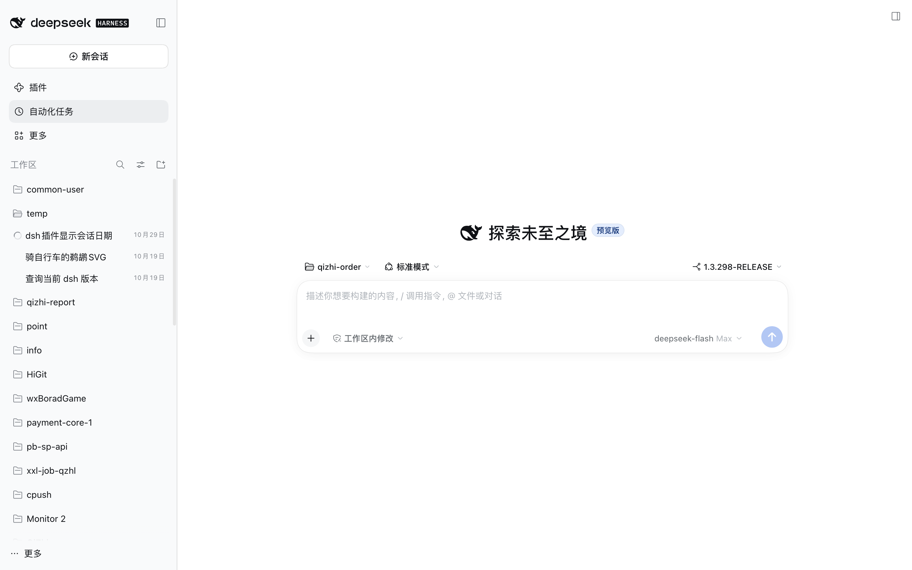
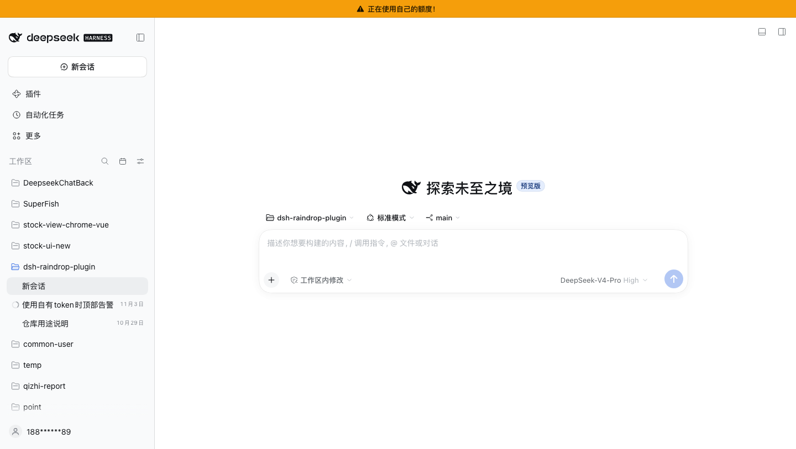
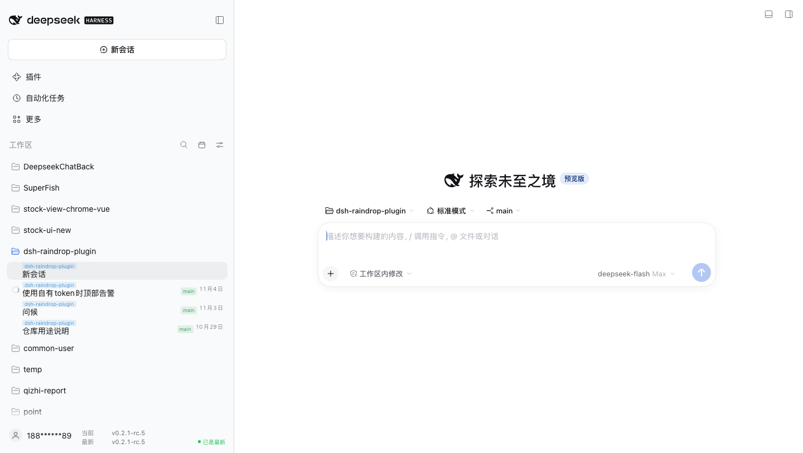

# dsh-raindrop-plugin

一个 DSH Web GUI 插件：把侧边栏会话列表里的**相对时间**（“刚刚 / 5分钟 / 3天 / 2个月”）换成**具体日期**，在侧栏头部加一个「日期视图」面板（切换首次对话/最后活动、按日期排序、按日期范围筛选），在“新会话”的工作区选择菜单里加一个**搜索框**，在每个会话标题上方显示**所属工作区/项目名**，在当前模型使用自己的 DeepSeek 账号额度时在**顶部显示告警**，在侧栏底部显示**当前与最新的 DSH 版本**，记住**刷新后不重置的侧栏宽度**，支持**悬停展开侧栏（可 pin 固定）**，并记录每个会话创建时所在的 **git 分支**（会话行显示分支徽标，重新打开会话时自动切回，也可悬停行后切换）。



```
之前：  刚刚    5分钟   3小时   3天     2个月
之后：  10月29日 10月29日 10月29日 10月26日 8月30日
```

跨年会话显示年份（`2025年10月29日`）；英文界面显示 `Oct 29` / `Oct 29, 2025`。

## 功能

- **行内日期**：每个会话行末尾显示日历日（默认“最后活动”，可切换为“首次对话”）。
- **工作区搜索**：打开“新会话”的工作区菜单后，顶部会出现搜索框。工作区菜单最多显示 5 行，其余滚动，搜索框和“添加工作区”固定在两端；输入时列表只保留匹配的工作区；`↑`/`↓` 移动高亮，`Home`/`End` 跳到第一个/最后一个匹配项，`Enter` 切到当前高亮项（没有高亮时优先名称完全匹配，其次第一个匹配项）。没有匹配时输入框下划线变橙色，`Enter` 不动作。每行在名称下方还会显示该项目的完整路径（浅灰小字）；一行放不下时省略中间的目录、保留开头和项目名，悬停可看完整路径。
- **自有额度告警**：当前会话选中的模型由自己的 DeepSeek 账号提供时（`deepseek-account` 账号登录路由或 `deepseek-official` 官方 API Key 路由），窗口顶部会固定显示一条琥珀色告警：**“正在使用自己的额度！”**（英文界面为 **“You are using your own quota!”**）。切到其他供应商后立即消失，不遮挡、不拦截操作。`qz` 等第三方网关有自己的计费，不会触发。
- **DSH 版本**：侧栏底部与账号同一行的右侧显示**当前**运行的版本和 npm 上的**最新** `@deepseek-ai/dsh` 版本，并用绿色 `已是最新` 或橙色 `可更新` 标记差异；每 15 分钟刷新一次，侧栏折叠时隐藏。
- **侧栏宽度记忆**：左侧栏可在 264px–420px 之间拖动；插件会记住宽度并在刷新后恢复，会话列表不会又缩回默认的 280px。折叠/窄屏模式下的宽度不保存，布局 store 不支持时回退到应用默认值。
- **悬停侧栏**：侧栏平时收起为 56px 图标条；鼠标移到图标条或侧栏上展开到记住的宽度，移开后 120ms 收起。侧栏标题栏里有一个 pin 按钮可固定打开，再点一次回到悬停模式；pin 状态会记住，悬停模式默认开启。收起时图标条只保留应用 logo 和底部账号；新建会话、插件、自动化、更多、添加工作区、搜索等快捷图标都隐藏，悬停展开后随完整侧栏一起回来。
- **项目标签**：每个会话行在标题上方显示所属工作区/项目名，做成浅蓝色的小标签（浅蓝底、浅蓝字），平铺的会话列表也能一眼看出 `dsh-raindrop-plugin` / `DeepseekChatBack` / `SuperFish` 等来源；悬停标题可看完整目录。项目名单独占一行，不占标题的横向空间。
- **会话 git 版本**：会话创建时记录其工作目录所在的 git 分支，会话行时钟旁显示浅绿色分支徽标（不一致时保持琥珀色警告）；重新打开会话时若当前分支与记录不一致，工作区干净就自动 `git switch` 回该分支，有未提交改动则只提示、不动工作区。悬停会话行时操作区会出现绿色分支徽标，点它可把这个会话切到另一个本地分支（要求工作区干净）并更新记录。
- **日期视图面板**：侧栏头部的日历按钮（侧栏展开时显示，在原生“视图选项”滑杆按钮左侧）。
  - 显示日期：`最后活动` / `首次对话`
  - 按日期排序：`默认（侧栏排序）` / `日期：新 → 旧` / `日期：旧 → 新`
  - 筛选日期：`全部` / `今天` / `近 7 天` / `近 30 天` + 自定义起止日期
  - `清除筛选`
- 选择结果保存在 `localStorage`，刷新页面后保持。
- 排序与筛选只影响侧栏当前渲染出来的行；工作区分组模式下按“每个展开的工作区内部”排序，折叠的工作区不会被自动展开。
- “首次对话”取自会话 header 的 `createdAt`（Host 侧读取）；如果“新会话”草稿被搁置很久后才使用，这个时间可能早于第一条消息。需要精确到“首条用户消息时间”的话还得扫描完整日志，暂未实现。

## 自有额度告警



告警跟随**当前屏幕上这条会话选中的模型**，不是全局账号状态：把模型切到第三方供应商，告警消失；切回「DeepSeek 账号」下的模型，告警回来。打开插件管理、设置等入口页时告警会继续保留，因为下一次请求仍会花自己的余额。

哪些供应商标记为“自有额度”由 [`lib/client.js`](lib/client.js) 顶部一个集合决定：

```js
const OWN_QUOTA_PROVIDERS = new Set(["deepseek-account", "deepseek-official"]);
```

`deepseek-account` 是 DeepSeek 账号登录路由，`deepseek-official` 是官方 API Key 路由。想连第三方账号一起提醒（例如 `"qz"`），把它的 provider id 加进去；不想提醒某个路由就从集合里删掉。这些 id 与模型选择器上的 `data-provider-id` 一致；插件不读取 API Key、账号 token 或账户余额。

## DSH 版本



侧栏底部与账号同一行显示两个版本，所有宽度都保持并排；窄侧栏时版本号会省略：

- **当前**取自当前页面的 boot manifest（`window.__DSH_BOOT__.release`），所以它精确对应当前标签页实际运行的构建；悬停可以看到 commit。
- **最新**取自 npm 的 `latest` dist-tag。Host 半在 `GET /dsh-version/latest` 提供并缓存 10 分钟；npm 暂时不可达时优先复用上一次成功结果，路由缺失时浏览器会直接回退到公开的 npm manifest。
- 绿色 `已是最新` 表示两个字符串一致；橙色 `可更新` 表示不一致；`检查中…` 是首次请求；`获取失败` 表示两个来源都没有响应。页面保持打开时每 15 分钟刷新一次，并跟随界面语言。
- 侧栏折叠时这一块隐藏。它只读取版本字符串，不会安装、更新或读取账号数据。

## 侧栏宽度

左侧栏可拖动范围是 264–420px，但应用的布局 store 每次加载都从 280px 开始。插件把最后一次拖动的宽度存在 `localStorage`（`dsh-raindrop-plugin:sidebar-width`），并在布局 frame 挂载后恢复，所以刷新不会把会话列表缩回默认宽度。

- 拖动结束后 200ms 防抖保存一次；264–420 以外的值（折叠/窄屏）忽略，保存的宽度不会强行展开侧栏。
- 恢复通过布局 frame 的 `setSidebar` action 完成；公开的 `ctx.layout` 服务只暴露折叠开关。如果 frame 结构变化，功能自动失效，保留应用默认宽度。
- 清除站点存储会忘记已记住的宽度。

### 悬停展开

默认情况下侧栏只显示 56px 图标条。鼠标移到图标条或侧栏上会展开到记住的宽度；移开后 120ms 收起。侧栏标题栏里的小 pin 按钮可以固定打开，再点一次回到悬停模式。pin 状态存在 `localStorage`（`dsh-raindrop-plugin:sidebar-hover`），悬停模式默认开启。

- 只要拖拽条在用，或任意菜单/浮层打开（视图选项、日期面板、分支选择器、工作区选择、账号/模型菜单），侧栏就保持展开，即使鼠标移到主区域；等菜单关闭且鼠标在外面再移动才收起。
- 侧栏收起时图标条只保留应用 logo 和底部账号。新建会话、插件、自动化、更多、添加工作区、搜索等原生快捷图标，以及 pin/日期按钮都隐藏；悬停展开后完整侧栏和所有控件一起回来。
- 侧栏收起时 pin 和日期按钮都隐藏；悬停展开后才能看到。pin 的 tooltip 在悬停模式下是 `固定侧栏`，固定后是 `启用悬停展开`。

## 项目标签


每个会话行的标题正上方有一条浅蓝色的项目标签：浅蓝底、浅蓝字。对于跨工作区平铺的会话列表，它能直接回答“这条会话属于哪个项目”。

- **名称来源**：优先取会话所属工作区的标题（公开 `workspaces` store 的成员关系），其次取 `cwd` 匹配到的最长工作区路径，再次取行所在的工作区分组标题，最后回退到 `cwd` 的最后一段目录名。
- **完整路径**：悬停标题显示原生 tooltip，内容是工作区或会话目录；标签不会读取提示词、消息或凭据。
- **布局**：项目名占 9px 一行，标题行收紧到 17px，两行共用原来的 32px 行高；项目名不占标题宽度，也不和右侧的日期、分支徽标抢位置。
- **更新**：会话列表或工作区列表变化、界面语言/布局重渲染时会重新标记。没有工作区、也没有可用 `cwd` 的会话不显示标签，其他行为不变。

## 会话 git 版本

会话创建时，Host 半读取该会话 `cwd` 的当前分支，存进 `$DSH_HOME/storages/raindrop-plugin-session-git.json`；文件里只有 `sessionId → { 分支, 目录 }`，没有提交内容、文件或提示词。

- **显示**：会话行的时钟位置左侧显示浅绿色分支小徽标（如 `dev-20261011`），悬停可看完整分支名；鼠标停在行上时该区域让位给原生操作按钮。
- **不一致**：目录当前分支与记录不同时，徽标变琥珀色，悬停提示同时给出两个分支。
- **自动回切**：只有**手动点会话行**打开会话时才回切，Host 重新读取真实分支：
  - 一致 → 什么也不做；
  - 不一致且工作区干净 → `git switch <记录分支>`，底部弹出绿色提示并刷新徽标；
  - 不一致但工作区有改动（含未跟踪文件）→ 不切换，弹出琥珀色提示；清理后再切回该会话即可重试；
  - 分支已删除、目录不是 git 仓库或处于 detached HEAD → 只提示，不切换。
  - **不会**回切的情况：新建会话、刷新/重开页面、由快捷键或列表变化切到会话、记录来自补记（`inferred`）、目标是空白会话。一个目录的 checkout 是共享的，这些场景自动切分支会把你刚 checkout 的分支悄悄换掉。
- **空白会话**：应用会把“新会话”复用一个空白会话，它的旧记录可能还是上一次的分支。插件对空白会话只**重记**当前 HEAD（`POST /session-git/record`），从不据此切换；等你真正发消息后，记录就是当前分支。
- **切换分支**：鼠标停在会话行上时，时钟区域让位给原生操作区，操作区左侧会出现同色绿色分支小徽标。点它打开该目录的本地分支选择器（可筛选，带 `当前` / `会话` 标记；输入筛选，`↑`/`↓` 高亮，`Enter` 切换）。选择后更新这个会话的记录；工作区干净时执行 `git switch`；有未提交改动、分支不存在或不是 git 仓库时只提示。
- 选择器是会话级的，但工作目录是共享的：切换一个会话会改变该目录的 checkout；同目录其他会话仍保留各自记录的分支，重新打开时可能再切回自己的分支。
- 回切和切换都只针对插件记录过的会话：请求只带 `sessionId`（切换多一个本地分支名），目录来自 Host 自己的记录，不能借此切到任意目录或 ref。
- 记录发生在会话创建时、空白会话成为当前会话时（重记当前 HEAD），或通过分支选择器切换时；插件安装前就存在的旧会话在第一次出现在列表时补记当时分支，并标记为 `inferred`，补记的记录不参与自动回切。

## 安装

从 npm 安装（推荐）：

```bash
dsh plugin --profile web add dsh-raindrop-plugin
```

本地源码 link 安装（开发用）：

```bash
# 在本目录执行（这是一个本地源码包，无需构建）
dsh plugin --profile web add /absolute/path/to/dsh-raindrop-plugin
```

包内声明了 `dsh.bundle.patch`，插件管理器会把它作为 profile 组合包安装、插入 `ui-raindrop-plugin` 行，并写入 `dsh.profile.bundles`。装完刷新一下浏览器页面即可；`lib/client.js` 是手写的、与官方客户端包相同的模块格式，不需要编译。

改动已安装（link）插件的**宿主侧**代码（`lib/index.js`）后，`dsh web` 会在下一次 profile 重载时替换它——修改一次 `~/.dsh/profiles/<name>/cordis.patch.yml`（例如加一行注释再删掉）或重启 `dsh web` 即可；客户端代码改动只需刷新页面。registry 安装是纯拷贝，改代码后需要重装。

卸载：

```bash
dsh plugin --profile web remove dsh-raindrop-plugin
```

## 调整日期格式

格式是 [`lib/client.js`](lib/client.js) 顶部的两个常量：

```js
const FORMAT = "localized"; // localized | numeric | iso
const SHOW_YEAR = "auto";   // auto | always | never
```

| FORMAT | 示例 |
| --- | --- |
| `localized`（默认） | `10月29日` / `Oct 29` |
| `numeric` | `10-29`（是否带年看 `SHOW_YEAR`） |
| `iso` | `2026-10-29` |

`SHOW_YEAR` 决定何时显示年份：`auto`（只有非当前年份才显示）、`always`、`never`。以 link 方式安装时，改完存盘、刷新页面即可，不用重装、不用构建；registry 安装是拷贝，改完需要重装。

也可以在 GUI 的插件设置里直接停用这个组合包，和普通插件一样。

## 实现原理

`@deepseek-ai/dsh-client-ui-workspace` 只发布了打包后的 `lib/client.js`，行内时间不是 slot，头部按钮列表也不是 slot，没有现成的声明式接缝。插件因此利用界面自身的稳定约定：

**行内日期**

1. 从公开的 `ctx.sessions` 会话仓库读取 `byId[id].updatedAt`；首次对话日期从本包的 Host 路由读取 `createdAt`。
2. 给每个 `[data-row-key="session:<id>"]` 行的时钟 `<span>`（CSS Module 类名以 `_time` 结尾）打上 `data-dsh-session-date` 属性，值为格式化后的日期。
3. 注入样式：隐藏该 `span` 的相对文字（`font-size: 0`），用 `::after { content: attr(...) }` 画出日期。React 始终拥有自己的文本节点，插件从不替换文本，因此重新渲染不会互相打架。
4. 用过滤过的 `MutationObserver`（只关心会话行和侧栏头部内的变动）加 `ctx.sessions.list` 订阅，在列表变化、新行插入、状态切换时重新打戳。处于“待审批”等状态的会话行（`aria-hidden="true"`）保留原状态文案。

**排序与筛选**

5. 行外层容器在排序开启时临时变成 flex 列，每行 wrapper 设置 CSS `order`；React 始终拥有文档顺序，插件从不移动节点。
6. 范围外的行加一个隐藏属性；工作区内的行全部被筛掉时整段隐藏，并在列表顶部显示“没有符合日期范围的会话”。

**Host 路由**

7. 浏览器拿不到 `createdAt`（`session.list` 只带 `updatedAt`），所以 Host 半用公开的 `sessionQuery.listSessions()` 读取 durable header，在 `GET /session-date/dates` 返回 `{ sessions: { [id]: createdAt }, fetchedAt }`。路由走 `connection.authorizeIndex` 的浏览器会话校验（无 cookie 返回 401），只暴露会话 id 与创建时间，不返回标题、提示词或路径；15 秒缓存。
8. 第二条校验路由 `GET /dsh-version/latest` 返回 npm `@deepseek-ai/dsh/latest` 的 `{ latest, checkedAt, stale? }`。它使用 8 秒超时，成功缓存 10 分钟、失败缓存 60 秒；刷新失败时优先返回上一次成功值，避免离线时丢掉已知版本。

**自有额度告警**

9. 输入框的模型标签带有 `data-provider-id`（官方 `conversation.input.model.label` 约定），这是实时来源；没有输入框的入口页（插件管理、设置）回退到 `ctx.sessions.list` 中当前会话的 durable `projectionValues.modelSelection.next` / `lastUsed`，并用“最后一次已知 provider”在页面切换期间兜底。
10. 告警条是挂在 `body` 上的固定元素；显示时给 `#root` 加 `data-dsh-own-quota` 属性，样式规则在顶部预留 32px 高的一条带，告警固定在带内；隐藏时移除属性，布局恢复原高。不移动、不替换任何 React 管理的节点。

**DSH 版本**

11. 当前版本来自 `window.__DSH_BOOT__.release`（版本 + 可选 commit），和模块系统使用的构建身份一致，所以它跟随标签页实际运行的构建，而不是某个包路径。
12. 最新版本来自上面的 Host 路由，Host 路由缺失时回退到公开 npm manifest。版本块插在 footer 中 `sidebar.settings` 之前；样式把它放在底部网格的右侧、与账号同级（所有宽度都并排；窄侧栏时版本号省略）。侧栏 footer 重新渲染时重新挂载，折叠时隐藏，插件每 15 分钟刷新一次。

**会话 git 版本**

13. Host 半监听公开的 `session/created` 事件，对 `header.cwd` 执行 `git -C <cwd> rev-parse --abbrev-ref HEAD` 记录分支；插件安装前的历史会话在 `GET /session-git/branches` 首次出现时补记。
14. `GET /session-git/branches` 返回 `{ sessions: { [id]: { branch, cwd, inferred, detached } }, current: { [cwd]: 当前分支 }, fetchedAt }`；`current` 让浏览器不执行 git 也能把徽标标成不一致，5 秒缓存。
15. `POST /session-git/restore` 只接受 `{ sessionId }`：重新读取真实分支，`git status --porcelain` 干净且分支存在时才 `git switch`（旧版 git 回退 `checkout`）；同一目录的请求串行化，避免并发切换。浅绿色徽标和日期共用行内时钟 `<span>`（日期用 `::after`、分支用 `::before`）。时钟区域在行悬停时让位给操作区，所以切换徽标是注入到原生操作区（`_rowActions`）里的独立按钮；行更新时重新挂载，清理时移除。
16. `POST /session-git/record` 只接受 `{ sessionId }`：读该会话目录的当前 HEAD 并覆盖记录，**不**执行 `git switch`；用于把被复用的空白会话的旧记录刷新成当前分支。会话没有记录时用 `sessionQuery` 找到它的 `cwd`，响应为 `ok | unknown | not-git`。
17. `GET /session-git/list?sessionId=` 用 `git for-each-ref refs/heads` 读本地分支和真实 HEAD；`POST /session-git/switch` 接受 `{ sessionId, branch }`，工作区脏、分支不存在或不是仓库时拒绝；成功执行 `git switch` 并只更新该会话的 `branch` / `recordedAt`；响应为 `switched | same | dirty | missing | not-git | unknown | error`；同一目录的请求共用 restore 锁。选择器始终把焦点留在筛选框：`↑`/`↓` 移动高亮行（循环，初始选中当前分支），`Enter` 切换；输入筛选后高亮重置到第一个匹配项。

**会话项目标签**

18. 公开的 `ctx.get("workspaces")` store 列出工作区的 `title`、`path` 和 `sessionIds`。插件先按成员关系匹配会话，再按 `cwd` 匹配最长的工作区路径前缀，再取行所在的工作区分组标题，最后回退到 `cwd` 的最后一段；完整路径写入标题 `<span>` 的原生 tooltip。
19. 标题 `<span>`（CSS Module 类名以 `_title` 结尾）加上 `data-dsh-session-project` 属性；样式把它画成标题上方的 9px 浅蓝色小标签，并把该行标题行高收紧到 17px，两行正好放进原来的 32px 行高。不插入、不替换任何 React 管理的文本节点或子节点；会话列表或工作区列表变化时重新打戳。

**侧栏宽度**

20. 布局 store 不持久化 `layoutInfo.sidebar`；`setSidebar` 会把宽度夹在 264–420，所以收起要用 `toggleSidebar`，展开/设置宽度用 `setSidebar`。插件把宽度和悬停/pin 状态存进 localStorage；加载时若悬停模式开启就收起到图标条，pin 固定则恢复宽度。`document` 的 `pointermove` 从图标条展开，并在指针离开时安排收起，但拖拽条在用或任意菜单/浮层打开时保持展开；标题栏的 pin 切换模式。frame 的 React action bag 和 pin 都是内部接缝；缺失时功能自动失效。

如果以后 DSH 改了 CSS Module 的类名，插件会回退到“时钟用行内第三个直接 `<span>`、标题用第二个直接 `<span>`”；如果整行结构都变了，它只会失效（变成 no-op），不会破坏行内容。排序/筛选同样只在结构匹配时生效。

## 兼容性

按 DSH `0.2.1-rc.5`（web profile）编写。客户端依赖 `sessions` 服务；Host 半依赖 `webServer`、`connection` 和可选的 `sessionQuery`（缺失时路由返回空表，日期回退到最后活动）。项目标签可选读取公开的 `workspaces` 服务；缺失时仍可用工作区分组标题或会话 `cwd` 得到项目名。自有额度告警使用模型标签的 `data-provider-id` 或会话的 `modelSelection` projection；两者都不存在时保持静默。版本块使用 `window.__DSH_BOOT__.release` 和 npm 支撑的 Host 路由；离线时显示“获取失败”，不会阻塞界面。侧栏宽度/悬停使用布局 frame 的内部 `setSidebar`/`toggleSidebar` action bag 和 56px 折叠图标条；缺失时保留应用默认行为。会话 git 版本依赖公开的 `session/created` 事件、`sessionQuery` 和可用的 `git`；目录不是仓库、git 缺失或事件缺失时只是没有徽标、不自动切换，不影响其他功能。分支选择器额外需要 Host 半的 `GET /session-git/list` 和 `POST /session-git/switch`；旧 Host 只显示读取失败，不改分支。
